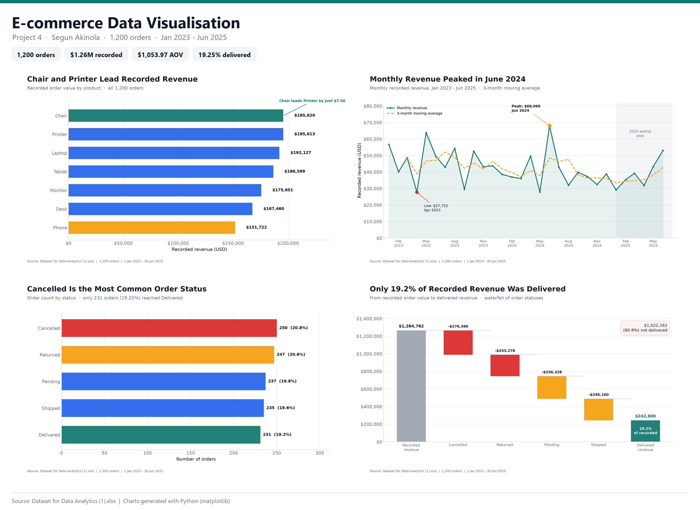
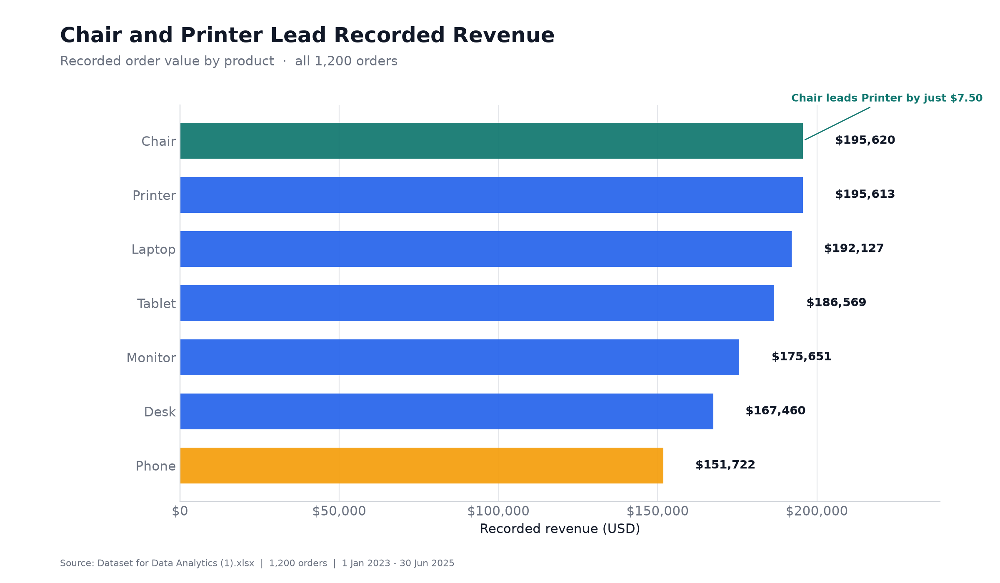
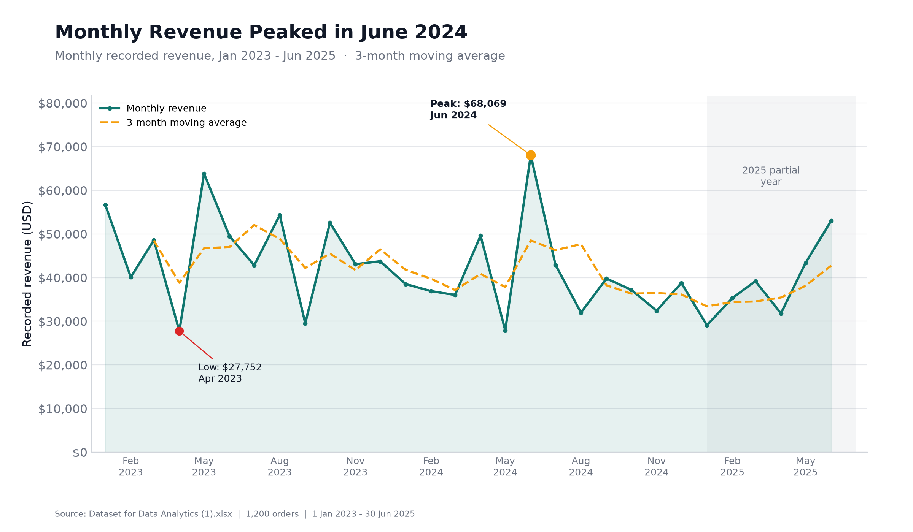
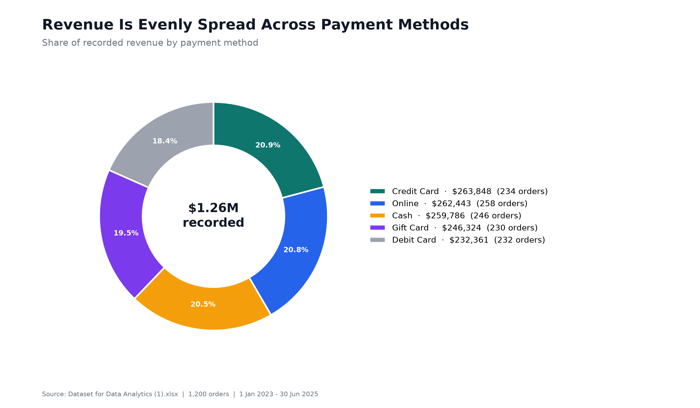
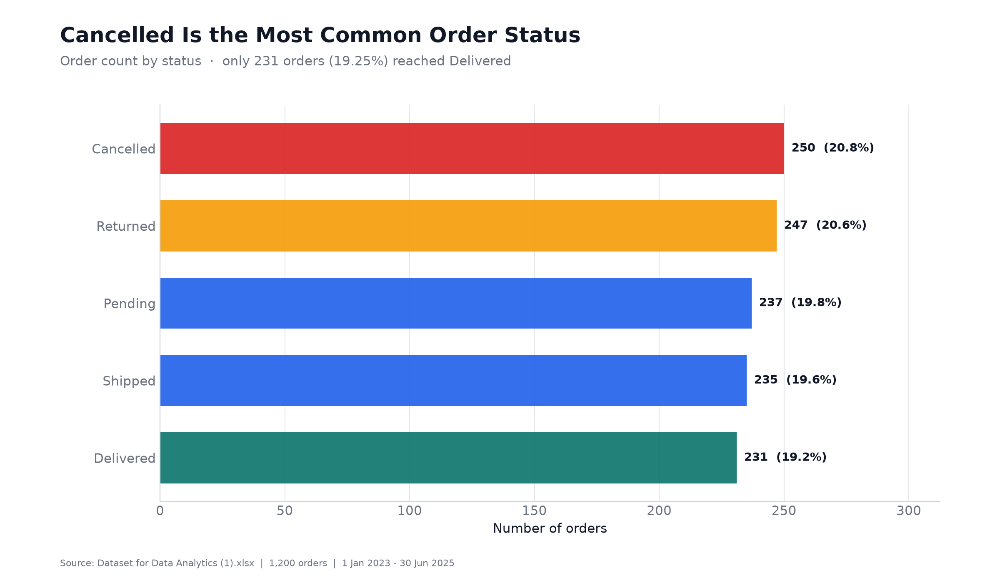
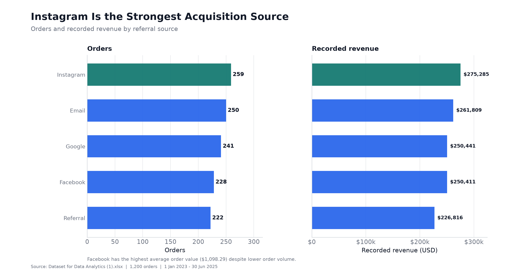
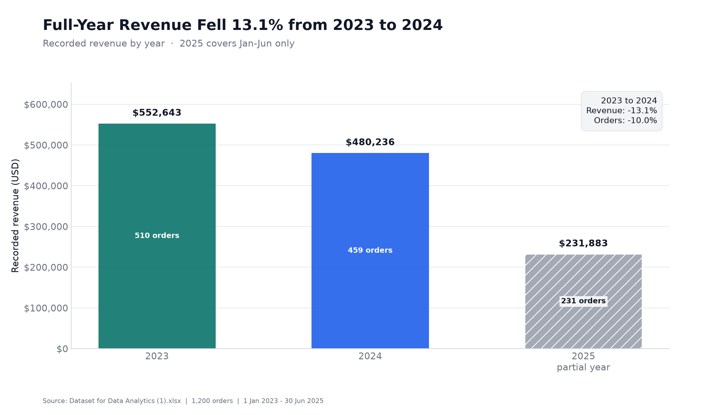
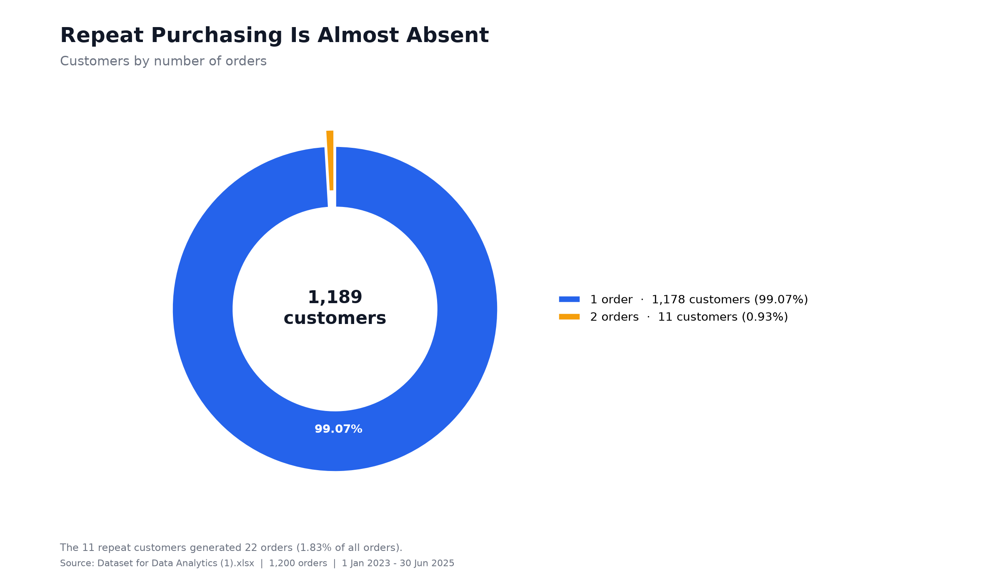
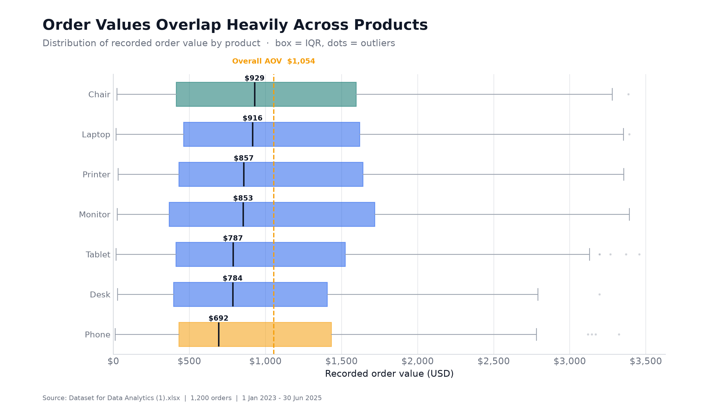
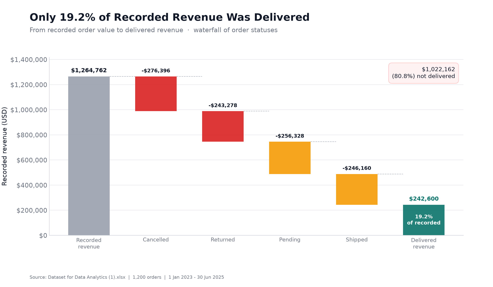

# Project 4: Data Visualisation

**Turning 1,200 e-commerce orders into clear, decision-ready visuals.**



---

## 1. Introduction

This project turns a 1,200-record e-commerce orders dataset into a visual story. The workbook covers orders placed between **1 January 2023 and 30 June 2025** across seven products, five payment methods, five order statuses, and five referral sources.

The aim is not simply to draw charts. The aim is to choose the right chart for each question, remove visual clutter, highlight the most important numbers, and communicate what the data means for the business.

All visuals were generated from the actual workbook using Python (`openpyxl` for reading, `matplotlib` for charting, and `Pillow` for the dashboard composite). The original Excel file was not modified.

---

## 2. Objectives

1. Explore the dataset and confirm its structure, record count, and data quality.
2. Select appropriate chart types for different analytical questions.
3. Build clear, labelled visuals that highlight the key patterns.
4. Use annotations and titles to tell a story, not just present data.
5. Summarise the most important business insights in a single dashboard.
6. Make the analysis reproducible with a documented Python script.

---

## 3. Dataset Overview

| Property | Value |
|---|---|
| Source file | `Dataset for Data Analytics (1).xlsx` |
| Worksheet | `Sheet1` |
| Records | **1,200 orders** |
| Columns | **14** |
| Date range | **2023-01-01 to 2025-06-30** |
| Unique customers | **1,189** |
| Products | **7** (Chair, Desk, Laptop, Monitor, Phone, Printer, Tablet) |
| Payment methods | **5** (Cash, Credit Card, Debit Card, Gift Card, Online) |
| Order statuses | **5** (Cancelled, Delivered, Pending, Returned, Shipped) |
| Referral sources | **5** (Email, Facebook, Google, Instagram, Referral) |
| Total recorded revenue | **$1,264,761.96** |
| Average order value | **$1,053.97** |
| Total quantity sold | **3,535 units** |

### 3.1 Data quality check

| Check | Result |
|---|---|
| Exact duplicate rows | **0** |
| Duplicate `OrderID` | **0** |
| Missing values outside `CouponCode` | **0** |
| Missing `CouponCode` | **309** records (25.75%) - treated as "no coupon" |
| `TotalPrice` = `Quantity × UnitPrice` | **All 1,200 records** |

**Important caveat:** "Recorded revenue" in this report is the sum of `TotalPrice` across all orders, including cancelled, returned, pending, and shipped orders. It is **not** realized sales. Delivered-only revenue is shown separately.

---

## 4. Tools and Design Approach

- **Python + openpyxl** - read the workbook without altering it.
- **matplotlib** - create the individual charts.
- **Pillow** - assemble the four-panel dashboard.
- **Consistent visual language** - teal for positive/leading values, red/orange for risk or deductions, blue for neutral categories, grey for context.
- **One message per chart** - each title states the insight, not just the variable name.
- **Direct labelling** - values sit next to the marks so the reader does not have to estimate.
- **Selective annotation** - only the highest, lowest, or most important points are called out.
- **Minimal chart junk** - no unnecessary gridlines, borders, or 3D effects.

---

## 5. Visualisations and Explanations

### 5.1 Revenue by product - horizontal bar chart



**What it shows:** Recorded revenue for each of the seven products, sorted from highest to lowest.

**Why this chart:** A horizontal bar chart is the clearest way to compare magnitudes across named categories, especially when labels are long.

**Insight:** **Chair** leads with **$195,620.11**, followed almost exactly by **Printer** at **$195,612.61** - a difference of only **$7.50**. **Phone** is the lowest at **$151,722.39**. Revenue is broad-based: every product contributes between **12.00% and 15.47%** of the total, so the business is not dependent on one product.

---

### 5.2 Monthly revenue trend - line chart



**What it shows:** Monthly recorded revenue from January 2023 to June 2025, with a 3-month moving average.

**Why this chart:** A line chart is the right choice for change over time. The moving average smooths month-to-month noise and makes the underlying direction easier to see.

**Insight:** **June 2024** was the strongest month at **$68,068.54**, while **April 2023** was the weakest at **$27,751.71**. Revenue is volatile month to month, and the 2025 values cover January-June only, so they should not be compared directly with full-year totals.

---

### 5.3 Payment method mix - donut chart



**What it shows:** Each payment method's share of recorded revenue, with order counts in the legend.

**Why this chart:** A donut chart works well for a small number of parts that make up a whole. Here, the five methods are close in size, so the chart communicates balance rather than dominance.

**Insight:** Revenue is remarkably evenly spread: **Credit Card 20.9%**, **Online 20.8%**, **Cash 20.5%**, **Gift Card 19.5%**, and **Debit Card 18.4%**. **Online** has the most orders (**258**), while **Credit Card** generates the most revenue (**$263,847.63**) and the highest average order value (**$1,127.55**).

---

### 5.4 Orders by status - horizontal bar chart



**What it shows:** The number of orders in each status, sorted by count, with each status's share of all orders.

**Why this chart:** The comparison is between named categories, so horizontal bars make the ranking and the gaps easy to read.

**Insight:** **Cancelled** is the most common status (**250 orders, 20.8%**), followed by **Returned** (**247, 20.6%**). Only **231 orders (19.25%)** reached **Delivered**. Cancelled and returned together account for **497 orders (41.42%)**, which is the clearest operational warning sign in the dataset.

---

### 5.5 Referral source - paired bar charts



**What it shows:** Orders and recorded revenue side by side for each referral source.

**Why this chart:** Two aligned bar panels let the reader compare volume and value without the distortion of a dual-axis chart.

**Insight:** **Instagram** is the strongest source by both orders (**259**) and revenue (**$275,285.45**). **Email** is second on both measures. **Facebook** has the highest average order value (**$1,098.29**) despite lower order volume, suggesting it attracts higher-value baskets.

---

### 5.6 Yearly revenue - vertical bar chart



**What it shows:** Recorded revenue for 2023, 2024, and 2025, with order counts inside the bars.

**Why this chart:** A vertical bar chart is a simple, honest comparison across a small number of periods. The hatched 2025 bar signals that the year is incomplete.

**Insight:** Comparing the two full years, revenue fell from **$552,643.24 in 2023** to **$480,235.87 in 2024**, a decline of **13.1%**. Orders fell from **510 to 459**, a decline of **10.0%**. The 2025 figure (**$231,882.85**, January-June) is a partial year and is not comparable with the full-year totals.

---

### 5.7 Customer loyalty - donut chart



**What it shows:** The share of customers who ordered once versus those who ordered twice.

**Why this chart:** The donut makes the imbalance immediately visible. The small exploded slice draws attention to the repeat segment without exaggerating it.

**Insight:** **1,178 of 1,189 customers (99.07%)** ordered only once. Just **11 customers (0.93%)** placed a second order, generating **22 orders** in total (**1.83%** of all orders). Retention is almost non-existent in this dataset.

---

### 5.8 Order value distribution by product - box plot



**What it shows:** The distribution of recorded order value for each product, including the median, interquartile range, whiskers, and outliers.

**Why this chart:** A bar chart of averages would hide the spread. The box plot shows typical values, variability, and extreme orders at the same time.

**Insight:** The product distributions overlap heavily. Median order values range from **$692 (Phone)** to **$929 (Chair)**, while the overall average order value is **$1,053.97**. High-value outliers exist for every product, which means product choice alone does not explain basket size.

---

### 5.9 Delivered revenue waterfall - waterfall chart



**What it shows:** How the **$1,264,761.96** recorded order value is reduced by cancelled, returned, pending, and shipped orders, ending at the **$242,600.32** delivered total.

**Why this chart:** A waterfall is the clearest way to show how a starting total is built down to an ending total. It makes the size of each status deduction visible.

**Insight:** Only **$242,600.32 (19.2%)** of recorded revenue was delivered. **$1,022,161.64 (80.8%)** sits in cancelled, returned, pending, or shipped orders. This is the single most important chart for interpreting the business: recorded revenue substantially overstates realized sales.

---

## 6. Dashboard


The dashboard combines the four most decision-relevant views:

1. **Revenue by product** - where the value comes from.
2. **Monthly revenue trend** - when the value arrives.
3. **Orders by status** - how much of the pipeline is at risk.
4. **Delivered revenue waterfall** - how much value is actually realized.

The KPI strip at the top gives the headline numbers: **1,200 orders**, **$1.26M recorded**, **$1,053.97 average order value**, and **19.25% delivered**.

---

## 7. Key Insights

### 7.1 Revenue is broad-based, not concentrated

- Chair and Printer are effectively tied for the top product revenue spot (**$195,620.11 vs $195,612.61**).
- Every product contributes between **12.00% and 15.47%** of recorded revenue.
- Every payment method contributes between **18.37% and 20.86%**.
- No single product or payment method dominates the business.

### 7.2 Fulfilment is the headline risk

- Only **231 orders (19.25%)** were delivered.
- Only **$242,600.32 (19.2%)** of recorded revenue was delivered.
- Cancelled and returned orders alone account for **497 orders (41.42%)**.
- Cancelled orders hold the largest single block of recorded value: **$276,396.21 (21.85%)**.

### 7.3 Instagram is the strongest acquisition channel

- Instagram: **259 orders** and **$275,285.45** in recorded revenue.
- Email: **250 orders** and **$261,808.55**.
- Google: **241 orders** and **$250,441.48**.
- Facebook: **228 orders** and **$250,410.90**, but the highest average order value (**$1,098.29**).
- Referral: **222 orders** and **$226,815.58**.

### 7.4 Retention is almost absent

- **1,189 unique customers** across 1,200 orders.
- **1,178 customers (99.07%)** ordered only once.
- **11 customers (0.93%)** placed a second order.
- The 11 repeat customers generated **22 orders (1.83% of all orders)**.

### 7.5 The two full years show a decline

- 2023: **$552,643.24** from **510 orders**.
- 2024: **$480,235.87** from **459 orders**.
- Revenue: **-13.1%**; orders: **-10.0%**.
- 2025 is a partial year (January-June) and should not be read as a full-year decline.

### 7.6 Order values overlap across products

- Median order values range from **$692 (Phone)** to **$929 (Chair)**.
- The overall average order value is **$1,053.97**.
- Outliers exist across every product, so product mix alone does not explain high-value orders.

### 7.7 Data caveat

Recorded revenue includes orders that were cancelled, returned, pending, or shipped. The delivered-only figure (**$242,600.32**) is a better proxy for realized sales than the headline **$1,264,761.96**.

---

## 8. Recommendations

1. **Investigate cancellations and returns first.** Together they represent 41.42% of orders and a large share of recorded value. Root-cause analysis should cover stock availability, delivery promises, payment failures, and return reasons.
2. **Report delivered revenue as the primary revenue KPI.** Recorded revenue is useful for pipeline analysis, but it overstates realized sales by roughly 5.2x in this dataset.
3. **Prioritize Instagram and Email for acquisition volume.** Instagram leads both orders and revenue; Email is a close second.
4. **Test higher-value offers for Facebook traffic.** Facebook has the highest average order value despite lower volume, making it a candidate for premium bundles.
5. **Build a retention programme.** With only 11 repeat customers, even a small improvement in second-purchase rate could materially change lifetime value.
6. **Examine the 2023-to-2024 decline.** The drop is visible in both revenue and order count, so it is not just a price/mix effect.

---

## 9. Reproducibility

### Requirements

```bash
pip install -r requirements.txt
```

### Run the chart script

```bash
python create_charts.py
```

The script uses the workbook at `data/Dataset for Data Analytics (1).xlsx` by default. To use a different file:

```bash
python create_charts.py "C:\path\to\your\workbook.xlsx"
```

### Outputs

- `charts/00_dashboard.png`
- `charts/01_revenue_by_product.png`
- `charts/02_monthly_revenue_trend.png`
- `charts/03_payment_method_mix.png`
- `charts/04_orders_by_status.png`
- `charts/05_referral_source.png`
- `charts/06_yearly_revenue.png`
- `charts/07_customer_loyalty.png`
- `charts/08_order_value_distribution.png`
- `charts/09_delivered_revenue_waterfall.png`
- `chart_data.csv` - the aggregated data behind the charts

---

## 10. Repository Contents

| File / folder | Purpose |
|---|---|
| `README.md` | Project report, chart gallery, insights, and recommendations |
| `create_charts.py` | Reproducible Python script that generates all charts |
| `chart_data.csv` | Aggregated data used by the charts |
| `requirements.txt` | Python dependencies |
| `data/Dataset for Data Analytics (1).xlsx` | Working copy of the source workbook |
| `charts/` | All exported PNG charts and the dashboard |

**Original source file:** `C:\Users\Prime\Downloads\Dataset for Data Analytics (1).xlsx` (unchanged).

---

## 11. Conclusion

The dataset is clean and easy to analyse, but the visual story is not simply "revenue is $1.26M". The charts show a business with broad-based product and payment revenue, a strong Instagram acquisition channel, and a serious fulfilment problem: only 19.2% of recorded revenue was delivered. Retention is also almost absent, with 99.07% of customers ordering only once.

The dashboard puts the four most important views in one place, while the individual charts provide the detail behind each message. Used together, they turn a flat spreadsheet into a clear narrative about where value comes from, where it leaks, and where the business should focus next.
